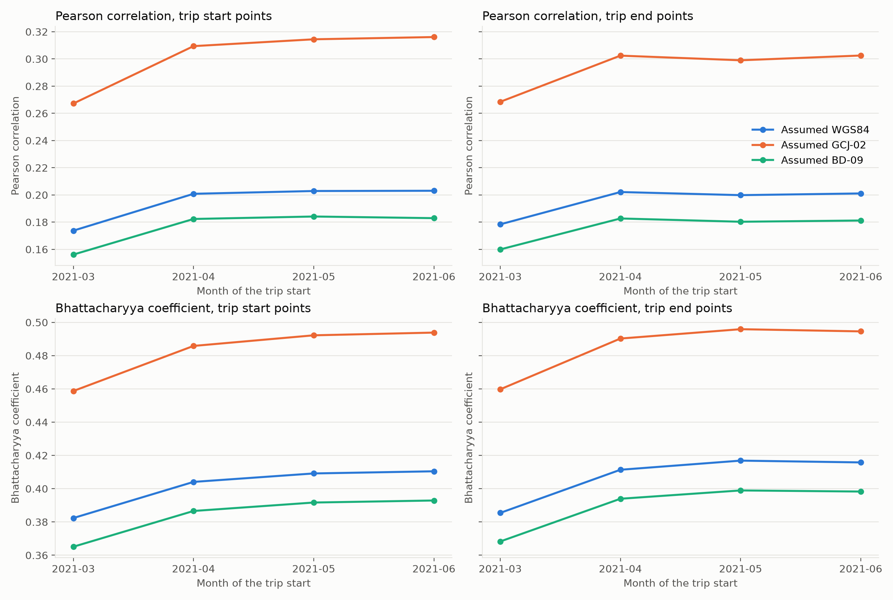
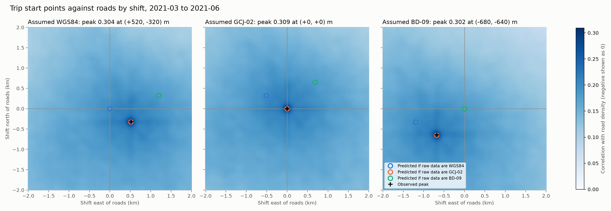

# Identifying the coordinate system of the Shenzhen bike trips

## 1. The question

The Shenzhen Municipal Government Data Open Platform, which publishes the dockless bike-sharing trips, states that the trip coordinates are in **BD-09**. A manual look at a few records suggested **GCJ-02** instead. Before the data are converted to WGS84, the global system used by GPS and OpenStreetMap, we must know which system they really are in.

This choice matters because the three systems are far apart in Shenzhen:

- GCJ-02 points sit about 600 m south-east of the WGS84 position, roughly 520 m east and 320 m south.
- BD-09 adds about another 930 m to the north-east on top of GCJ-02, roughly 680 m east and 640 m north.

These offsets are far larger than GPS error and the distance between a parked bike and the street. If the coordinates are read in the wrong system, every trip end lands on the wrong street block.

## 2. The idea

Dockless bikes are picked up and parked along streets, so trip start and end points cluster along the road network. OpenStreetMap is in WGS84.

The test reads the raw coordinates under each candidate system, converts them to WGS84, and compares the resulting point density with the density of the cycling network:

- **Right system:** the trip ends sit on the roads and match them best.
- **Wrong system:** they are displaced from the roads by the offset between the true system and the assumed one, and the match is weaker.

## 3. Data

- **Period:** trips that started from March to June 2021, about 140.8 million trips inside the test area. 
- **Area:** only points within Shenzhen's official extent, 22.45–22.87° N and 113.77–114.62° E, measured on the raw coordinates. Points with missing coordinates are dropped.
- **Trip starts and ends separately:** a start is where a bike was picked up and an end is where it was parked. If the operator recorded them differently, the two would point to different systems.
- **Sampling:**
  - Each month and trip end is scored on a random sample of 1,000,000 points.
  - For the whole period, the four monthly samples are pooled (4,000,000 points per trip end).

## 4. Method

1. **Road network.** The test uses the OpenStreetMap network open to cycling in the Shenzhen area: public ways, without motorways or ways closed to bicycles. Each street is counted once, whatever its number of directions.
2. **Grid.** One regular grid of 20 m cells covers the area, in UTM zone 50N (a metric projection), 2,391 × 4,414 cells (north–south × east–west).
3. **Road density.** The road length in each cell is smoothed with a Gaussian kernel of 40 m standard deviation. The bandwidth must stay far below the 600–930 m offsets between the systems, or every assumption would look alike.
4. **Trip-end density under each assumption.** For each candidate system (WGS84, GCJ-02, BD-09), the raw coordinates are assumed to be in that system and converted to WGS84. They are then counted per cell and smoothed with the same kernel.
5. **Scores at zero shift.** Each trip-end density is compared with the road density in two ways:
   - **Pearson correlation:** how well the trip-end density follows the road density, cell by cell.
   - **Bhattacharyya coefficient:** how much the two overlap as probability distributions, from 0 for no overlap to 1 for identical ones. It does not drive the decision, but the right system should rank first on both scores.
6. **Lag scan.** The correlation is also computed with the trip ends shifted against the roads, for every shift up to 2 km east–west and north–south.
   - **Right system:** the best shift is zero.
   - **Wrong system:** the best shift reproduces the offset between the true and the assumed system. This gives a second, independent check.
7. **Decision.**
   - The assumed system with the highest Pearson correlation wins.
   - The result is marked "no fit" if the winner's best shift lies more than 60 m from zero.
   - It is marked "ambiguous" if the winner leads the runner-up by less than 0.02 in correlation.
   - Otherwise it is marked "ok".
8. **Positive control.** The method must be shown able to recover a known system:
   - The pooled sample of each trip end is converted to WGS84 with the detected system.
   - It is then deliberately re-expressed in each of the three systems and tested again.
   - The control passes if the injected system is recovered with status "ok" every time.

## 5. Results

### Whole period, March to June 2021

| Trip end | Points in area | Sampled   | Detected | Margin over runner-up | Residual shift | Status |
| -------- | -------------- | --------- | -------- | --------------------- | -------------- | ------ |
| Start    | 140,763,491    | 4,000,000 | GCJ-02   | 0.109                 | 0 m            | ok     |
| End      | 140,819,230    | 4,000,000 | GCJ-02   | 0.101                 | 0 m            | ok     |

| Trip end | Assumed system | Pearson   | Bhattacharyya | Best shift east | Best shift north | Correlation at best shift |
| -------- | -------------- | --------- | ------------- | --------------- | ---------------- | ------------------------- |
| Start    | WGS84          | 0.200     | 0.413         | +520 m          | −320 m           | 0.304                     |
| Start    | **GCJ-02**     | **0.309** | **0.496**     | **0 m**         | **0 m**          | **0.309**                 |
| Start    | BD-09          | 0.181     | 0.395         | −680 m          | −640 m           | 0.302                     |
| End      | WGS84          | 0.202     | 0.419         | +500 m          | −320 m           | 0.298                     |
| End      | **GCJ-02**     | **0.303** | **0.498**     | **0 m**         | **0 m**          | **0.303**                 |
| End      | BD-09          | 0.182     | 0.401         | −680 m          | −640 m           | 0.296                     |

Assuming GCJ-02 gives the highest correlation, by a clear margin, and the highest Bhattacharyya coefficient. Its best shift is exactly zero.

Under the two wrong assumptions the best shift is not zero. It falls where the GCJ-02 offset predicts:

- **Read as WGS84:** the points stay displaced by the GCJ-02 offset, about 520 m east and 320 m south.
- **Read as BD-09:** the conversion over-corrects by the BD-09 offset, about 680 m west and 640 m south.

The correlation at those shifted peaks is close to the GCJ-02 value. So the wrong assumptions fail only because the points are displaced, not because the data match the roads poorly.

### By month

| Month   | Trip end | Points in area | Detected | Margin | Residual shift | Status |
| ------- | -------- | -------------- | -------- | ------ | -------------- | ------ |
| 2021-03 | Start    | 3,051,255      | GCJ-02   | 0.093  | 0 m            | ok     |
| 2021-03 | End      | 3,051,221      | GCJ-02   | 0.090  | 0 m            | ok     |
| 2021-04 | Start    | 50,779,587     | GCJ-02   | 0.109  | 0 m            | ok     |
| 2021-04 | End      | 50,799,962     | GCJ-02   | 0.100  | 0 m            | ok     |
| 2021-05 | Start    | 44,393,158     | GCJ-02   | 0.112  | 0 m            | ok     |
| 2021-05 | End      | 44,417,458     | GCJ-02   | 0.099  | 0 m            | ok     |
| 2021-06 | Start    | 42,539,491     | GCJ-02   | 0.113  | 0 m            | ok     |
| 2021-06 | End      | 42,550,589     | GCJ-02   | 0.101  | 0 m            | ok     |

Every month gives the same answer for both trip ends, and so does the whole period. In every month the ranking is the same on both scores: GCJ-02 first, WGS84 second and BD-09 last (Figure 1). March 2021, when data collection was still ramping up, has lower scores than the later months; even so, GCJ-02 leads by a margin of 0.09.

*Figure 1. Pearson correlation (top) and Bhattacharyya coefficient (bottom) of trip starts (left) and trip ends (right) with the road network, by month and assumed system.*

### Lag scans

Figures 2 and 3 show the lag scans for the whole period. Each figure has one panel per assumed system. Each panel shows how the correlation with the roads changes as the trip ends are shifted east (horizontal axis) and north (vertical axis):

- The grey lines cross at zero shift, and the black cross marks the observed peak.
- The coloured rings mark where the peak should lie if the raw data were really in that ring's system.

Under the GCJ-02 assumption the peak sits at the crossing of the grey lines. Under the WGS84 and BD-09 assumptions it sits on the orange GCJ-02 ring, away from zero. All three panels therefore point to GCJ-02.

*Figure 2. Correlation of trip start points with the road network as a function of shift, under each assumed system, March to June 2021.*

*Figure 3. As Figure 2, for trip end points.*

## 6. Positive control

| Trip end | Injected system | Detected | Margin | Residual shift | Status | Passed |
| -------- | --------------- | -------- | ------ | -------------- | ------ | ------ |
| Start    | WGS84           | WGS84    | 0.113  | 0 m            | ok     | yes    |
| Start    | GCJ-02          | GCJ-02   | 0.109  | 0 m            | ok     | yes    |
| Start    | BD-09           | BD-09    | 0.126  | 0 m            | ok     | yes    |
| End      | WGS84           | WGS84    | 0.105  | 0 m            | ok     | yes    |
| End      | GCJ-02          | GCJ-02   | 0.101  | 0 m            | ok     | yes    |
| End      | BD-09           | BD-09    | 0.119  | 0 m            | ok     | yes    |

When the data are deliberately put into each of the three systems, the method recovers that system every time, with margins of 0.10–0.13 and zero residual shift. So on these data the method tells the three systems apart reliably, and its verdict of GCJ-02 is not an artefact of the method.

## 7. Conclusion

- **System:** the source documentation says the trip coordinates are BD-09, but the evidence shows they are **GCJ-02**:
  - GCJ-02 wins in every month from March to June 2021, for both trip starts and trip ends;
  - it matches the road network best on both scores;
  - it is the only assumption with zero residual shift;
  - the wrong assumptions are displaced by exactly the offsets GCJ-02 predicts;
  - the positive control confirms that the method can tell the systems apart.
- **Conversion:** the raw coordinates are therefore treated as GCJ-02 and converted to WGS84 during preprocessing (see [data_preprocessing.md](data_preprocessing.md)). After the conversion the trips line up with WGS84 maps and spatial data such as OpenStreetMap.
- **Scope:** the test covers trips from March to June 2021. It assumes the coordinate system did not change within the data. The same result in four consecutive months supports that assumption, but months outside the test window were not checked here.
