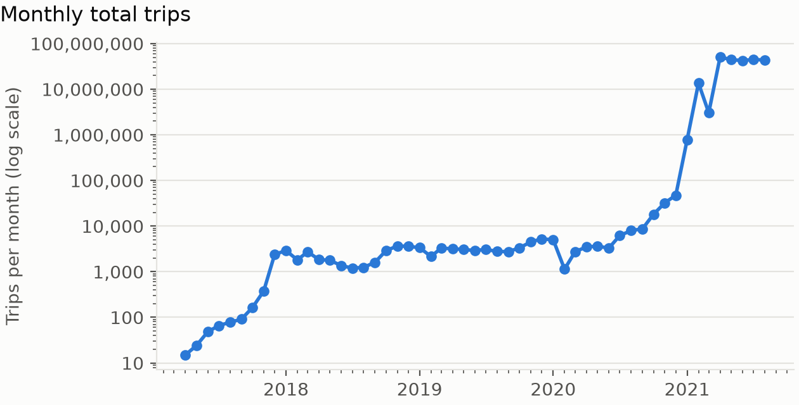
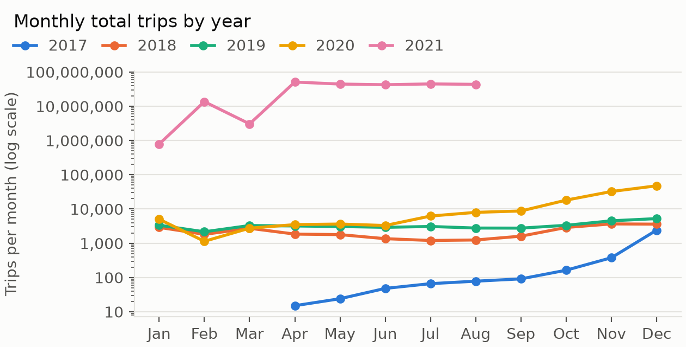
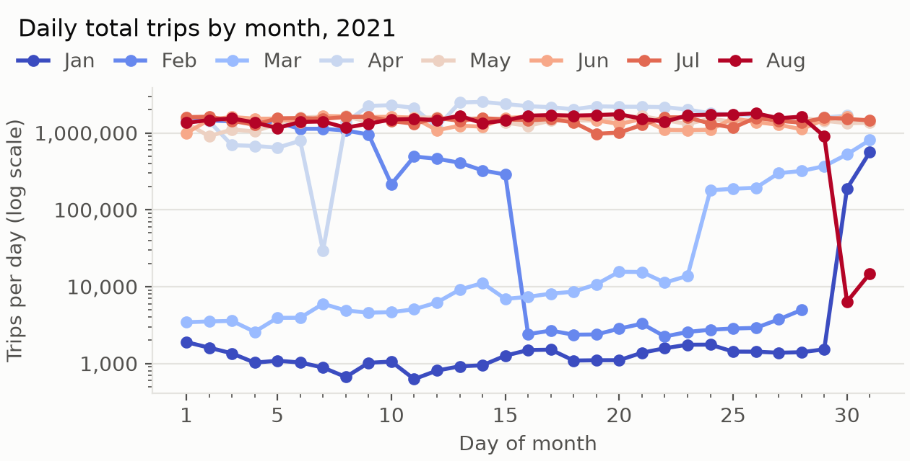

# Data description and preprocessing

This document describes where the Shenzhen dockless bike-sharing trips come from and how they are turned into the trip set used for analysis. It covers the raw files and their format, the cleaning and coordinate conversion, the processed files, the temporal exploration that selects the study period, and the screening of the study-period trips. The numbers come from the logs and result files of the latest pipeline run.

## 1. Data source

### 1.1 Provider

The trips come from the Shenzhen Municipal Government Data Open Platform (深圳市政府数据开放平台, opendata.sz.gov.cn), which publishes bike-sharing order records through a paged web API. Each record is one bicycle trip with:

- its start and end time;
- its start and end coordinates;
- a masked user identifier.

The two earliest files also carry a `COM_ID` field whose value is always `0755**` or empty. 0755 is the Shenzhen telephone area code, which suggests a masked city-level company identifier.

**Coordinate system.**

- The platform states that the coordinates are **BD-09**. A month-by-month test of the trip ends against the OpenStreetMap road network shows that they are in fact **GCJ-02**.
- The test is described in [crs_detection.md](crs_detection.md). The raw files therefore hold GCJ-02 coordinates. The cleaning step converts them to WGS84, so the processed data and every later output are in WGS84.

### 1.2 Collection

The data were downloaded page by page from the API:

- Pages hold about 10,000 rows each; a 1,000-page file has 10,001,000 rows.
- The page numbers in file names are API page indices, not row counts or dates.

### 1.3 Raw files

The raw data are five zip archives in `data/raw/`, totalling 8.86 GB compressed and 31.27 GB uncompressed. Each archive `bicycle_trip_<a>_<b>.zip` contains a folder of the same name with trip files `bicycle_trip_<x>_<y>.csv`.

| Archive                      | Zip size | Trip CSVs | Uncompressed CSVs |
| ---------------------------- | -------- | --------- | ----------------- |
| bicycle_trip_0_4999.zip      | 1.81 GB  | 6         | 6.48 GB           |
| bicycle_trip_5000_9999.zip   | 1.81 GB  | 5         | 6.38 GB           |
| bicycle_trip_10000_14999.zip | 1.82 GB  | 5         | 6.38 GB           |
| bicycle_trip_15000_19999.zip | 1.79 GB  | 5         | 6.36 GB           |
| bicycle_trip_20000_24999.zip | 1.63 GB  | 5         | 5.68 GB           |

## 2. Raw data format

Each trip CSV has a header row and these fields:

| Field      | Raw format                 | Description                                      |
| ---------- | -------------------------- | ------------------------------------------------ |
| START_TIME | `YYYY-MM-DD HH:MM:SS[.0]`  | Trip start time (local time)                     |
| START_LAT  | decimal degrees            | Start latitude, GCJ-02                           |
| START_LNG  | decimal degrees            | Start longitude, GCJ-02                          |
| END_TIME   | `YYYY-MM-DD HH:MM:SS[.0]`  | Trip end time                                    |
| END_LAT    | decimal degrees            | End latitude, GCJ-02                             |
| END_LNG    | decimal degrees            | End longitude, GCJ-02                            |
| COM_ID     | `0755**` or empty          | Masked company code; only in the first two files |
| USER_ID    | 22 hex characters + 10 `*` | Masked user identifier                           |

Known quirks of the raw files:

- **Time format.** Most files write times with a `.0` fraction (230,320,893 start times); the earliest rows have none. The fraction is always zero.
- **Coordinate system.** The source states BD-09, but the data are GCJ-02 (Section 1.1).
- **Coordinate precision.** Coordinates are written with varying numbers of decimals.
- **User masking.** `USER_ID` is 22 lowercase hexadecimal characters followed by exactly 10 `*` mask characters.
- **Order.** Rows are not sorted by time, within or across files.
- **Extra column.** `COM_ID` appears only in `bicycle_trip_0_999.csv` and `bicycle_trip_1000_1435.csv`.
- **Size.** Individual CSVs are 0.6–1.3 GB uncompressed.

## 3. Cleaning and coordinate conversion

All trip CSVs are cleaned and merged by `scripts/clean_up_raw_data.py`. A full run takes about 60 minutes and holds all data in memory. The steps are:

1. **Read.** Every `bicycle_trip_*.csv` member is streamed directly out of the zip archives and read with all columns as text. `COM_ID` is not read.

2. **Validate.** A row is rejected when:
   
   - a datetime does not match the 24-hour `YYYY-MM-DD HH:MM:SS` format, optionally with fractional seconds;
   - a coordinate is not a number with |latitude| ≤ 90 and |longitude| ≤ 180;
   - `USER_ID` is not a lowercase hex prefix followed by exactly ten `*`.
   
   Missing values fail. The first failed check is recorded.

3. **Round times.** Fractional seconds are rounded to the nearest second, half up. Because every fraction in the data is `.0`, no value changed.

4. **Convert to WGS84.** The start and end points of every row that passes validation are converted from GCJ-02 to WGS84.
   
   - **Method:** GCJ-02 has no closed-form inverse, so the published GCJ-02 forward transform is inverted by three fixed-point iterations.
   - **Rejection:** a row is rejected when a converted point is not finite, falls outside the global coordinate range, or misses its GCJ-02 input by more than 1 cm when transformed back. The iteration diverges only near the poles.
   - **Result:** no row failed. In every file the shift has a median of about 605 m and a 99th percentile of at most 615 m, and the largest inversion error is 0.09 mm.

5. **Deduplicate and sort.** Rows that are identical in every retained field are dropped, and the trips are sorted by `START_TIME` (stable). The comparison uses the converted coordinates; this is equivalent to comparing the raw values because the conversion is deterministic.

6. **Compact.**
   
   - Coordinates are stored as float32, with a maximum rounding error of $7.5 × 10^{-6}$ degrees (under 1 m).
   - The 22-character hex part of `USER_ID` (the provider's masked identifier without its ten `*`) is replaced by an int32 `USER_KEY`, numbered in sorted `USER_ID` order; the mapping is stored separately.

7. **Write.**
   
   - Trips and users are written as zstd-compressed Parquet.
   - Rejected rows are written to CSV with their source file, data row and reason, and every step is logged.
   - The trip file records its coordinate system (WGS84) in its metadata, and the later scripts stop with an error if that record is missing.

| Stage                                          | Rows        |
| ---------------------------------------------- | ----------- |
| Rows read from the trip CSVs                   | 244,673,004 |
| Lines skipped as malformed (wrong field count) | 0           |
| Rows rejected by validation                    | 15          |
| Rows rejected by WGS84 conversion              | 0           |
| Exact duplicates dropped                       | 721,642     |
| Trips written                                  | 243,951,347 |

| Reject reason     | Rows | Note                                                                             |
| ----------------- | ---- | -------------------------------------------------------------------------------- |
| invalid END_LAT   | 5    | End latitude and longitude swapped (for example END_LAT = 113.9, END_LNG = 22.5) |
| invalid START_LAT | 5    | Corrupted numbers such as 1000, 596016 or −2.3 × 10⁹                             |
| invalid START_LNG | 3    | As above                                                                         |
| invalid USER_ID   | 2    | The ten-`*` mask with no hex prefix                                              |

Rejected rows are a negligible fraction (0.000006 %) of the data. Exact duplicates make up 0.29 % of the rows read, consistent with overlapping API pages.

## 4. Processed data

| File                                        | Contents                                           |
| ------------------------------------------- | -------------------------------------------------- |
| `data/processed/bicycle_trips.parquet`      | 243,951,347 trips in WGS84, sorted by `START_TIME` |
| `data/processed/bicycle_users.parquet`      | `USER_KEY` to `USER_ID` mapping (10,768,628 users) |
| `data/processed/bicycle_trips_rejected.csv` | The 15 rejected raw rows with their reasons        |
| `data/processed/clean_up_raw_data.log`      | Processing log                                     |

Columns of `bicycle_trips.parquet`:

| Column     | Type          | Unit            | Description                                          |
| ---------- | ------------- | --------------- | ---------------------------------------------------- |
| START_TIME | timestamp (s) | local time      | Trip start, whole seconds                            |
| START_LAT  | float32       | degrees (WGS84) | Start latitude                                       |
| START_LNG  | float32       | degrees (WGS84) | Start longitude                                      |
| END_TIME   | timestamp (s) | local time      | Trip end                                             |
| END_LAT    | float32       | degrees (WGS84) | End latitude                                         |
| END_LNG    | float32       | degrees (WGS84) | End longitude                                        |
| USER_KEY   | int32         | –               | Anonymous user key; joins to `bicycle_users.parquet` |

Columns of `bicycle_users.parquet`:

| Column   | Type   | Description                                                                    |
| -------- | ------ | ------------------------------------------------------------------------------ |
| USER_KEY | int32  | 0-based key, in sorted `USER_ID` order                                         |
| USER_ID  | string | 22-character hex part of the provider's masked `USER_ID`, without the `*` mask |

The processed data keep implausible trips, such as negative or very long durations and points outside Shenzhen. These are removed only for the study-period extract (Section 6).

## 5. Temporal exploration

`scripts/exploratory_data_analysis.py` counts the trips on the calendar date of their start time. Dates without trips are kept as zero so that gaps remain visible. Because volume spans about six orders of magnitude, the figures use a logarithmic y axis. The most important property of the data is their uneven coverage over time:

- before 2021 the data hold only 209,876 trips in total, about 1,000–1,500 per day by late 2020;
- from April 2021 they hold 1–2.5 million trips per day.

### 5.1 Monthly volume

*Figure 1. Total trips per month, April 2017 to August 2021 (log scale). April 2017 starts on the 3rd.*

Monthly volume grows from tens of trips in 2017 to a plateau of roughly 1,100–5,200 trips per month in 2018–2020, rises from late 2020, and jumps to tens of millions in 2021. The peak months are April 2021 (50,810,171 trips) and May–August 2021 (about 43–45 million each).

*Figure 2. Total trips per calendar month, one line per year (log scale).*

By calendar month, 2021 is 100 to 10,000 times larger than any earlier year, so pre-2021 data cannot be compared with 2021 on the same footing. The February dips in 2018–2020 coincide with Spring Festival.

### 5.2 Daily volume in 2021

*Figure 3. Total trips per day of month, one line per month of 2021 (log scale).*

Daily counts in 2021 reveal several collection gaps:

- January has about 1,000 trips per day until the 29th.
- February is at full volume until the 9th and falls to about 2,000–5,000 per day from the 16th.
- March stays below 16,000 per day until the 23rd and then ramps up.
- 2021-04-07 has only 29,180 trips.
- The data end on 2021-08-31, with 6,342 and 14,813 trips on the last two days.

The busiest day is 2021-04-14 with 2,533,925 trips. 56 calendar days in the full range have no trips at all.

### 5.3 Coverage periods and the study period

| Period                       | Days    | Trips           | Mean / day    | Min – max / day         | Pattern                                   | Use                   |
| ---------------------------- | ------- | --------------- | ------------- | ----------------------- | ----------------------------------------- | --------------------- |
| 2017-04-03 to 2021-01-29     | 1,398   | 245,952         | 176           | 0 – 2,732               | Sparse trickle; not the full system       | Exclude               |
| 2021-01-30 to 2021-02-09     | 11      | 12,118,228      | 1,101,657     | 189,278 – 1,445,062     | Full volume, then Spring Festival cut-off | Short usable window   |
| 2021-02-10 to 2021-03-31     | 50      | 5,280,969       | 105,619       | 2,241 – 807,295         | Collapse to ~2,000/day, slow ramp-up      | Exclude               |
| 2021-04-01 to 2021-04-07     | 7       | 5,668,033       | 809,719       | 29,180 – 1,419,422      | Qingming holiday and a 1-day gap (04-07)  | Exclude               |
| 2021-04-08 to 2021-04-30     | 23      | 45,142,138      | 1,962,702     | 1,182,995 – 2,533,925   | About 50 % above later level until 04-23  | Robustness check only |
| **2021-05-01 to 2021-08-28** | **120** | **174,568,119** | **1,454,734** | **905,152 – 1,798,197** | **Steady complete coverage**              | **Study period**      |
| 2021-08-29 to 2021-08-31     | 3       | 927,908         | 309,303       | 6,342 – 906,753         | End of data; partial days                 | Exclude               |

The study period is **2021-05-01 to 2021-08-28**: 120 consecutive days and 174,568,119 trips, with no gaps. 2021-08-29 is excluded because its 906,753 trips are well below other August Sundays (1.17–1.40 million) and it directly precedes the end of the data.

From 2021-04-09 to 2021-04-23 volume is about 2.2 million trips per day, roughly 50 % above the May–August level. This is not double counting:

- on 2021-04-14 fewer than 100 trips share a user and start time;
- there are 905,312 distinct users that day, against 806,995 on 2021-05-12;
- every hour has trips.

Whether the surge is real demand or a change in the providers included cannot be told from the data, so April is best used only as a robustness check.

Low days inside the study period appear to be real events, so they should be kept and flagged rather than removed:

- the May Day holiday (05-01 to 05-05);
- the Dragon Boat holiday (06-12 to 06-14);
- 06-22 to 06-24, about 1.09 million trips per weekday; the cause is not identified;
- 07-19 to 07-20, about 1.0 million trips per day; this coincides with Typhoon Cempaka, but was not checked against weather records.

## 6. Study-period trip extract

`scripts/selected_period_trips.py` builds the analysis dataset from `data/processed/bicycle_trips.parquet`. It writes `output/selected_trips/bicycle_trips_selected_period.parquet`, the per-check counts in `output/selected_trips/filter_summary.csv`, and a run log. It takes about 2 minutes. It stops with an error if the input is not marked as WGS84 or the period holds no trips. The steps are:

1. **Select the period.** Only trips starting from 2021-05-01 to 2021-08-28 (inclusive) are read.

2. **Screen invalid trips.** Using the WGS84 coordinates of the processed data, a trip is removed when:
   
   - its duration is outside 1–180 minutes;
   - its straight-line (haversine) distance is outside 0.1–30 km;
   - its start or end point lies outside the official extent of Shenzhen (22°27′–22°52′ N, 113°46′–114°37′ E), widened by at least 5 km on every side;
   - its straight-line speed is outside 1–25 km/h.
   
   Missing values fail.

3. **Write.** Kept trips are written with the same seven columns as the input, in `START_TIME` order, with float32 WGS84 coordinates. Duration, distance and speed are used only for screening and are not stored.

| Check           | Rule                                 | Failing    | Removed in order | Remaining   |
| --------------- | ------------------------------------ | ---------- | ---------------- | ----------- |
| study period    | 2021-05-01 to 2021-08-28             | –          | –                | 174,568,119 |
| travel time     | 1 ≤ duration ≤ 180 min               | 2,568,196  | 2,568,196        | 171,999,923 |
| travel distance | 0.1 ≤ distance ≤ 30 km               | 7,031,405  | 5,250,774        | 166,749,149 |
| boundary        | start and end in Shenzhen box + 5 km | 215,113    | 1,253            | 166,747,896 |
| travel speed    | 1 ≤ speed ≤ 25 km/h                  | 13,193,089 | 7,857,214        | 158,890,682 |

The extract keeps **158,890,682** of the 174,568,119 trips in the period (91.0 %).

- **Failing** counts every trip that fails a check.
- **Removed in order** counts the trips a check removes after the checks above it.

About half of the speed removals are faster than 25 km/h, typically about 10 km in 7 minutes, which points to a wrong end coordinate. The other half are slower than 1 km/h. Straight-line distance understates loops and round trips, so some of these may be genuine leisure rides; the lower limit can be relaxed in the script.
